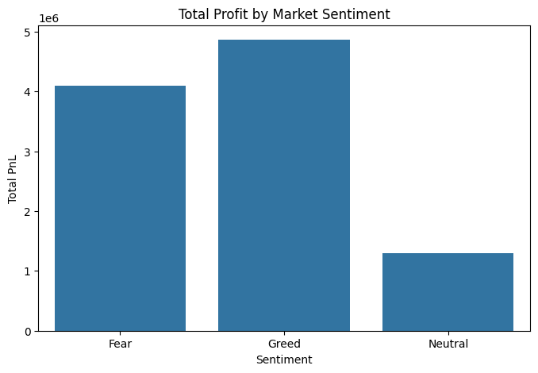
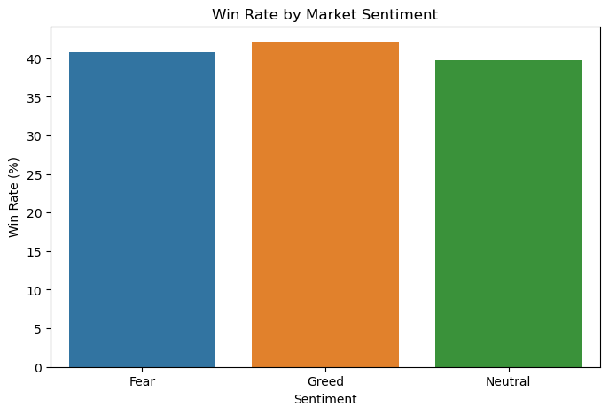
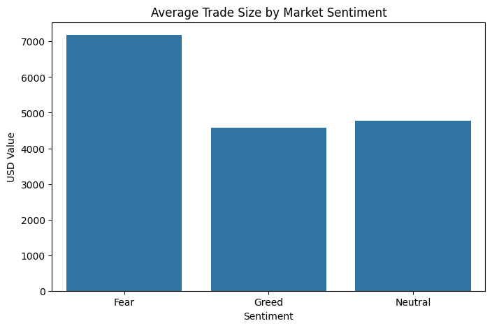

# Trader Behavior Sentiment Analysis – Primetrade.ai Assignment

## Google Colab Notebook:

https://colab.research.google.com/drive/1PHLeStzmWyDy-RtFhAcw0yZ1_1GuSwvo?usp=sharing

---

## Question

Does market sentiment (Fear vs Greed) change how traders perform?

## Key Findings

- [Finding 1, with the number. Example shape: "Total PnL was X% higher on Greed days than Fear days."]
- [Finding 2: win rate by sentiment]
- [Finding 3: average trade size by sentiment]
- [Who the top traders were in each regime and what they did differently]

## Method

- Data: Fear & Greed Index, Hyperliquid historical trader data ([number] rows after cleaning)
- Steps: [cleaning steps], merged on date, grouped by sentiment, compared PnL, win rate and trade size
- Tools: Python, Pandas, Matplotlib, Jupyter

## Charts





## Recommendations

- [One or two actions a trader or business could take based on the findings]

---

## Project Structure
```
ds_SyedAbbasMujthahed/
├── notebook_1.ipynb
├── csv_files/
│   ├── fear_greed_index.csv
│   ├── historical_data.csv
│   ├── top_greed_traders.csv
│   ├── top_fear_traders.csv
├── outputs/
│   ├── total_pnl_by_sentiment.png
│   ├── winrate_by_sentiment.png
│   ├── avg_trade_size_by_sentiment.png
├── ds_report.pdf
└── README.md
```

--- 

## Execution Instructions
1. Open notebook_1.ipynb in Google Colab

2. Upload project folder

3. Run cells sequentially

4. Outputs and charts are saved automatically

## Datasets Used:
- Fear & Greed Index
  
- Hyperliquid Historical Trader Data

---

## Summary

This project analyzes how market sentiment impacts trading performance and identifies top-performing traders under different market regimes.
